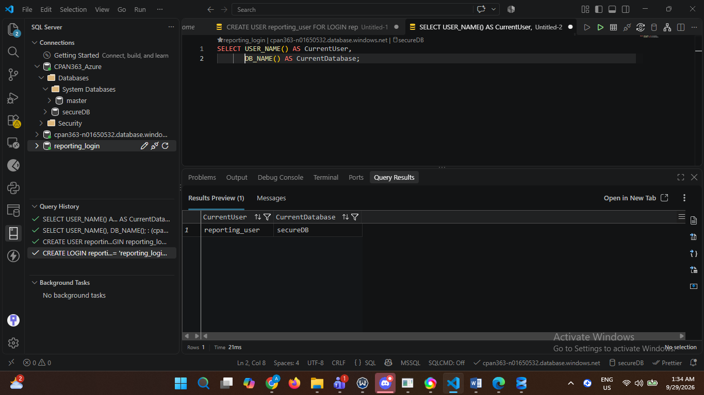
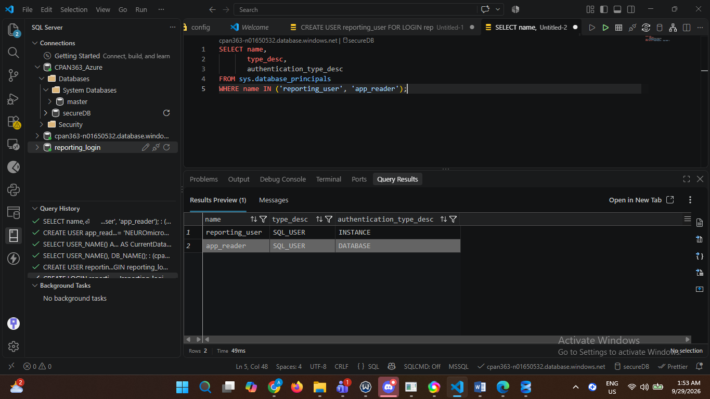
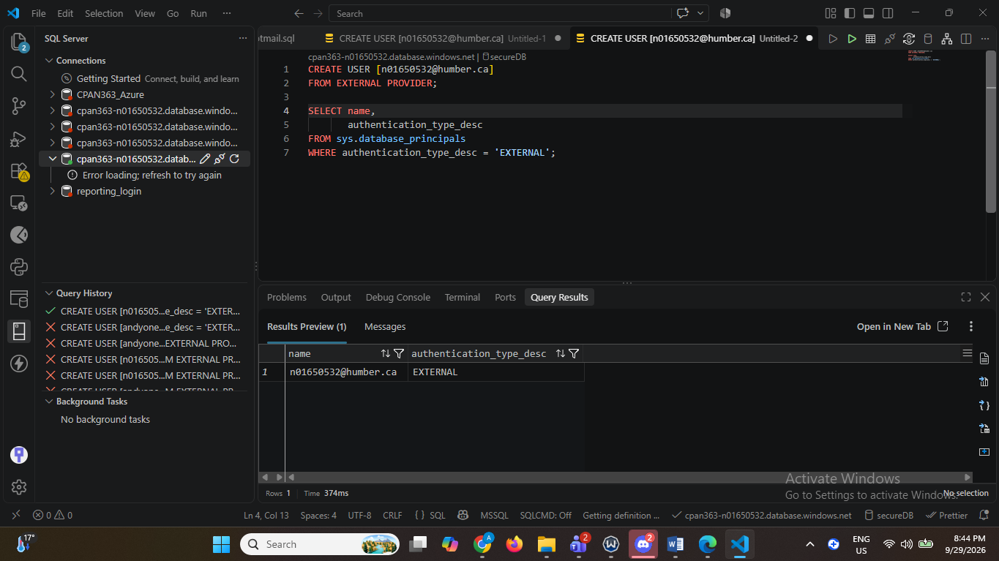
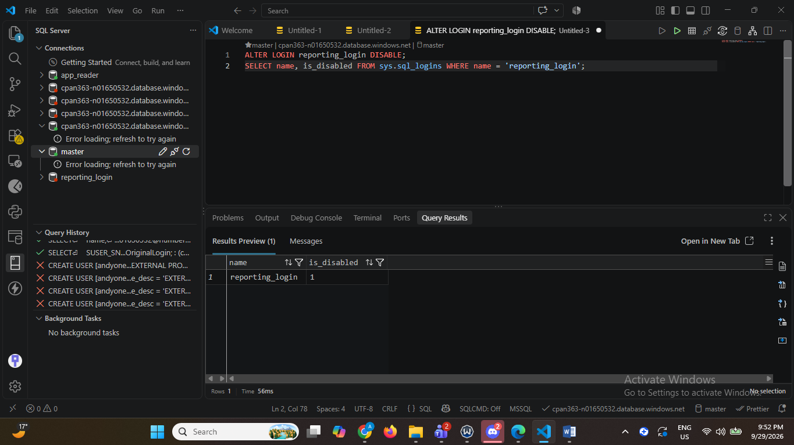
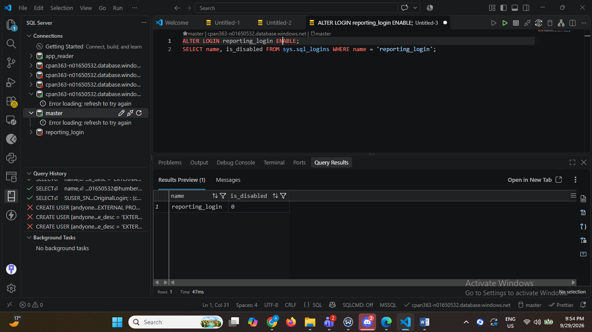

# Lab 02: Logins, Users and Microsoft Entra

An Azure SQL identity and access management case study covering login-to-user mapping, contained users, Microsoft Entra authentication, and access suspension and restoration.

## Objective and contribution

Distinguish authentication from database access, diagnose a missing database-user mapping, compare identity types, and test controls for withdrawing access. Implemented the course exercises and captured actual VS Code results; this portfolio version organizes the evidence and removes personal and connection information.

## Documented outcomes

| Exercise | Evidence reviewed |
| --- | --- |
| Login without database-user mapping | Initial connection error, followed by successful connection after mapping |
| Login mapped to reporting_user | Query returns reporting_user and secureDB |
| Contained versus login-based user | app_reader = DATABASE; reporting_user = INSTANCE |
| Microsoft Entra | Administrator and MFA setup screenshots; external database principal returned |
| DENY CONNECT / GRANT CONNECT | Commands and failed/successful connection screenshots in the private report |
| Disable / enable login | is_disabled changes from 1 to 0 |

These are historical results reviewed from the supplied report. No database was rerun during portfolio preparation. An MFA prompt alone is not proof of a completed database session; the external-principal result is a separate piece of evidence.

## Screenshot evidence

The following are cropped excerpts from original screenshots. Result values are unchanged. Surrounding interfaces, server addresses, personal identifiers, and authentication prompts are excluded.

### Successful login-to-user mapping

### Authentication types

### External principal

The principal name is omitted from this crop to protect the account identity. This shows the external authentication type, not an MFA policy assessment.

### Login suspended and restored

Disabled, is_disabled = 1:

Enabled, is_disabled = 0:

## Security analysis

- A SQL login and its database user are different objects. Creating the login did not create a user in the target database; the mapping resolved the access failure.
- A contained SQL user authenticates at the database level. Its database-contained identity avoids dependence on the original server login when moving a database, subject to destination configuration and connectivity.
- An Entra-backed user delegates identity to the external provider. The lab demonstrates configuration and principal creation, not a comprehensive tenant security review.
- DENY CONNECT restricts the database user in one database. Disabling the server login affects new authentication through that login across its database mappings. Neither result should be presented as proof that every existing session was terminated.
- For an application, separate end-user identities from the backend service identity and grant the service only required database permissions. The clinic answers are design discussion, not an implemented architecture.

## Reproduction and scope

See [logins-users-entra.sql](sql/logins-users-entra.sql). Run sections manually using the explicitly named connection context: master, target database administrator, new SQL-login connection, contained-user connection, or Entra connection.

Passwords and the Entra identity are placeholders, so the script is a reference template rather than a turnkey installer. Replace them only in a private working copy. Never commit actual credentials. The Entra administrator must be configured for the lab, and the external identity must exist and be resolvable in the tenant.

Use isolated course resources. Object creation is not rerunnable and overlaps with subsequent labs. Do not execute against the completed Lab 3 or Lab 5 database. Connection tests require fresh sessions; the statements alone do not reproduce the client sign-in tests.

## Portfolio preparation notes

The supplied SQL omitted DISABLE even though the report shows it. This reference version restores that documented command and explicitly labels connection contexts. A personal Entra address (with a spelling discrepancy in the source SQL) is replaced with a generic placeholder. No new execution results are claimed.

Based on CPAN 363 Lab 2: Logins, Users and Microsoft Entra. Course-provided patterns and the author's exercise results are organized here with AI assistance in preparation and documentation. The instructor handout, full report, credentials, and personal account details are not redistributed.

Continue to [Lab 3: Permissions and Roles](../03-permissions-and-roles/README.md) for authorization, least privilege, and auditing.
