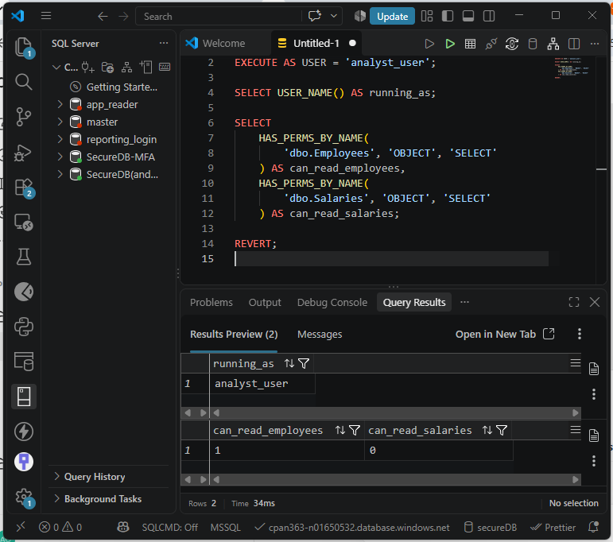
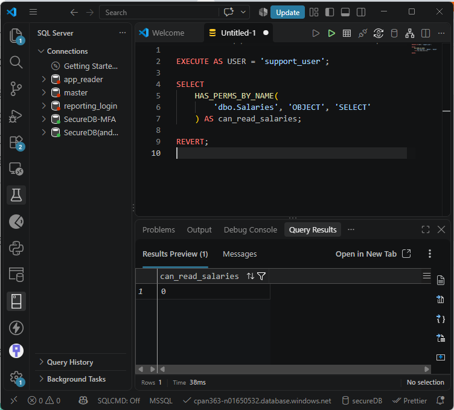
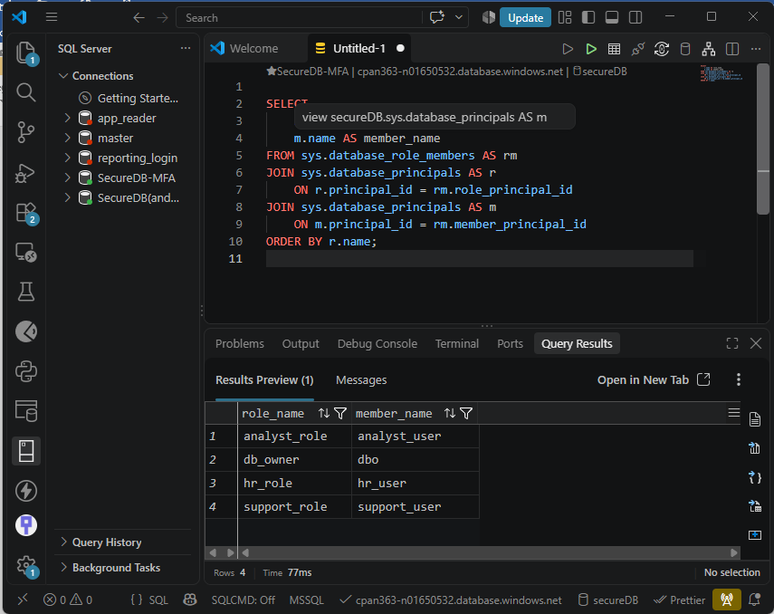
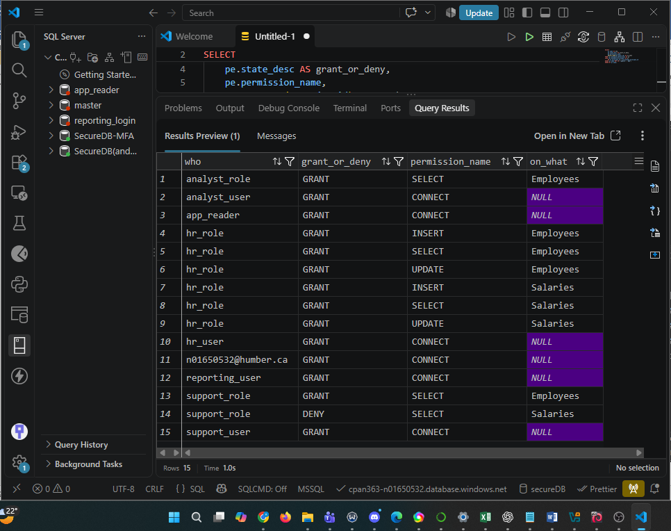

# Lab 03: Permissions and Roles

An Azure SQL least-privilege case study: define job-based roles, verify effective access under each user, and investigate an inherited permission conflict.

## Security objective

Allow support and analysts to read ordinary employee records while reserving salary access and personnel maintenance for HR. Verify actual access rather than assuming that GRANT statements are sufficient.

## Permission model

| Role | Employees | Salaries |
| --- | --- | --- |
| support_role | SELECT | Explicit DENY SELECT |
| hr_role | SELECT, INSERT, UPDATE | SELECT, INSERT, UPDATE |
| analyst_role | SELECT | No SELECT grant |

Each role has one test user created WITHOUT LOGIN. These users have no passwords and are tested with EXECUTE AS USER, followed by REVERT.

## Documented results

| Test | Result in the supplied lab report |
| --- | --- |
| Support SELECT permissions | Employees = 1; Salaries = 0 |
| Support direct queries | Employee read succeeded; salary read failed with error 229 |
| HR effective permissions | All six SELECT, INSERT, UPDATE checks returned 1 |
| HR direct reads | Both tables readable |
| Analyst SELECT permissions | Employees = 1; Salaries = 0; direct salary read failed |
| Support temporarily added to db_datareader | Salary permission remained 0; salary read failed |
| Final membership audit | Three custom role assignments; no support_user membership in db_datareader |

The HR write results are permission checks, not evidence of actual INSERT or UPDATE operations. The original report and screenshots were reviewed; this portfolio preparation did not rerun the database.

## Screenshot evidence

These are cropped excerpts of the actual VS Code screenshots embedded in the original lab report. Cropping removes the surrounding interface, student identifiers, and connection details; the displayed result values are unchanged. No new database execution was performed for these images.

### Support effective permissions

The execution context is support_user. Employee SELECT permission is 1, while salary SELECT permission is 0.

### DENY versus inherited GRANT

The report records this permission check during the temporary db_datareader test: salary SELECT remains 0. This result excerpt does not itself show the role-add command; the reproduction SQL contains that step.

### Final role membership

The final audit shows the three custom role memberships and the existing dbo membership in db_owner. The temporary support_user membership in db_datareader is absent.

### Support permission audit excerpt

Rows 13 and 14 of the original audit show, from left to right: row number, principal, permission state, permission name, and object. These entries grant employee SELECT and deny salary SELECT. Other audit rows are omitted from this excerpt, including a personal account identifier.

## Why the controls matter

Support has an explicit table-level DENY, while analyst merely lacks a salary grant. In the demonstrated db_datareader test, the support DENY overrides the inherited read grant. This is the tested object-level case, not a claim about every possible SQL Server privilege configuration.

The final audit lists nine custom-role permission entries. Additional database CONNECT entries in the original environment are not additional table grants to these roles. Catalog permission entries explain configured grants and denials; they do not alone calculate every effective permission.

For a developer requesting db_owner to troubleshoot, first establish the task, required objects, actions, and duration. Offer scoped access to relevant data or approved diagnostics and remove the temporary access when the investigation ends.

## Reproduction

Open [the sanitized SQL script](sql/permissions-and-roles.sql) in VS Code with the SQL Server extension.

1. Use an isolated, empty Azure SQL lab database and an administrator connection.
2. Run setup sections in order. CREATE commands are not rerunnable.
3. Run denied-query tests separately. If an error interrupts execution, run REVERT in the same connection and check USER_NAME before continuing.
4. Remove temporary db_datareader membership as administrator.
5. Inspect the role membership and permission audit outputs.

**Do not run this historical script against the completed Lab 5 database.** Lab 5 uses overlapping role/user names and moves tables into app and sensitive schemas. The two labs are separate snapshots, not cumulative installers. The script has not been executed during portfolio preparation.

## Relationship to Lab 5

Lab 3 establishes role-based access. [Lab 5](../05-stored-procedures-sql-injection/README.md) extends the learning to schema permissions, ownership chaining, stored procedures, and SQL injection remediation.

## Attribution and evidence

Based on CPAN 363 Lab 3: Permissions and Roles. The course supplied the exercise and SQL patterns; the author implemented and documented the tests, with AI assistance in preparation and documentation. All employee records are fictional.

The original report includes a student identifier, server address, and account identifier. It remains private. This public case study includes reviewed result excerpts without reproducing those details.
