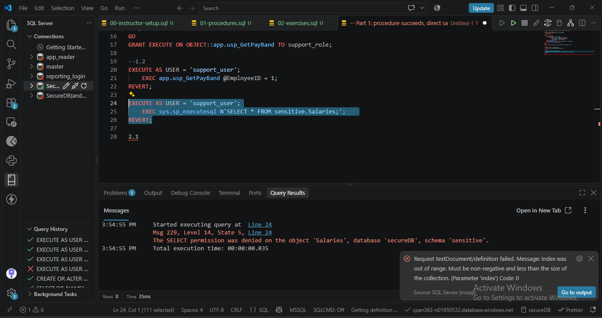
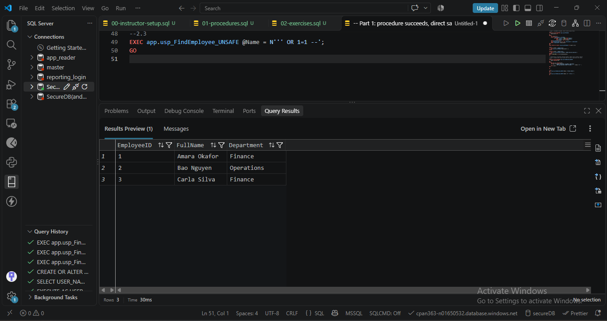
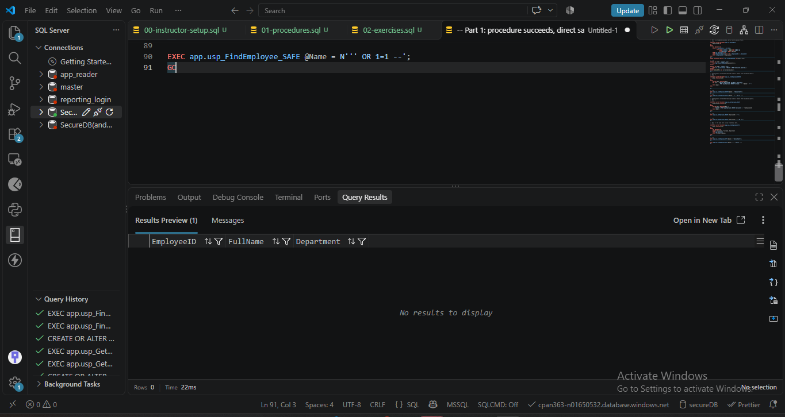

# Stored Procedures and SQL Injection

## Prerequisites

An isolated Azure SQL course database with fictional data, the course Lab 5 setup completed, and an administrator connection with the required database permissions. No connection secrets are supplied by this repository.

The instruction setup is redistributed here. It creates:

- `app`, `sensitive`, and `reporting` schemas owned by `dbo`.
- `app.Employees` with EmployeeID INT, FullName NVARCHAR(100), Department NVARCHAR(60), and OfficePhone VARCHAR(20).
- `sensitive.Salaries` with EmployeeID INT and Salary MONEY.
- Three fictional employees: Amara Okafor (ID 1), Bao Nguyen (ID 2), and Carla Silva (ID 3), with salaries 62000, 58000, and 71000 respectively.
- `support_role` with SELECT on the app schema and DENY SELECT on sensitive.
- `support_user WITHOUT LOGIN`, a member of support_role.
- HR and analyst roles and users, reporting views, and additional permissions used by the course model.

This package depends on that setup; it is not a standalone database installer.

## Run order

1. Confirm you are connected to the intended lab database, not master.
2. Run [01-procedures.sql](sql/01-procedures.sql).
3. Run [02-exercises.sql](sql/02-exercises.sql) one labeled section at a time. Review result grids and expected errors. If interrupted during impersonation, run REVERT in the same connection.
4. After capturing results, run [03-cleanup.sql](sql/03-cleanup.sql). The final verification should return NULL for both unsafe procedure IDs when run as administrator.

GO is a client batch separator supported by the VS Code SQL Server extension. In a client that does not support it, execute batches separately.

## Identity and request flow

The database client authenticates to Azure SQL using credentials managed outside this repository. The lab test users have no logins or passwords; EXECUTE AS changes the database execution context, and REVERT restores it.

For the pay-band test, support_user receives procedure execution permission through support_role. The procedure's static query follows the common ownership chain to read salary data and returns only an employee ID, name, and band. A separate direct salary query checks the user's permissions and fails.

For injection tests, the administrator calls the unsafe procedures. They concatenate values into command text and execute it. The safe versions use static SQL, so supplied values do not become SQL syntax. No application login service, JWT, refresh token, or token storage is implemented.

# Evidence checklist

This document is an observed database result.

The repository shows evidence screenshots, reviewed redacted copies deliberately.

| Capture | Expected on fresh fixture | Actual result / private capture reference |
| --- | --- | --- |
| Setup report | All checks OK | [screenshot](evidence/01-part1.png) |
| Support pay-band procedure | Employee 1, Amara Okafor, Band B | [screenshot](evidence/02-part1.png) |
| Support direct salary read | Permission denied | [screenshot](evidence/03-part1.png) |
| Unsafe name, normal | 1 row | [screenshot](evidence/01-part2.png)/[screenshot](evidence/02-part2.png) |
| Unsafe name, injection | 3 rows |[screenshot](evidence/03-part2.png) |
| Unsafe ID, normal | 1 row | [screenshot](evidence/01-part3.png) / [screenshot](evidence/02-part3.png) |
| Unsafe ID, injection | 3 rows | [screenshot](evidence/03-part3.png) |
| Safe name, normal | 1 row | [screenshot](evidence/01-part4.png) / [screenshot](evidence/02-part4.png) |
| Safe name, same injection | 0 rows | [screenshot](evidence/02b-part4.png) |
| Safe ID, normal | 1 row | [screenshot](evidence/03b-part4.png) |
| Safe ID, same injection | Conversion error | [screenshot](evidence/03c-part4.png) |
| Cleanup | Both unsafe procedure IDs NULL | [Completeted](evidence/01-part5.png) |

## Explanations after running
### Role-based permission 

- **Part 1:** 
The support user can get a pay band because its role has EXECUTE permission on the stored procedure, and ownership chaining allows the procedure to read the salary table while returning only the pay band. The user cannot read actual salaries directly because its role is explicitly denied SELECT permission on the sensitive schema.

### SQL Injection return every row

- **Part 2:**
The unsafe procedure joins the supplied name directly into the SQL command. The injected quote closes the name value, OR 1=1 makes the condition true for every row, and -- comments out the remaining quote. This changes the query’s meaning instead of searching for a literal name. As a result, the injected search returned all three employees instead of only Amara Okafor.

### Parameterized search blocks injection

- **Part 4:**
The fixed procedures use parameters directly in static SQL, so the supplied values cannot change the query’s structure. The name procedure treats the injection text as a literal name and returns no matches, while the integer parameter rejects 1 OR 1=1 with a conversion error. A procedure parameter alone is not enough to prevent injection if its value is later concatenated into executable SQL.

The same injection input returned zero rows after the fix.

- **Part 5:**
The role model limited users to the permissions needed for their jobs, reducing the damage an attacker could cause through SQL injection. For example, the support role could read employee information but was denied direct access to the sensitive salary table. Injection would still be restricted by the permissions of the execution context; because these injection tests ran as the administrator, they had broader access than a support user would.

## Part 5.1: search-procedure checklist

| Check | UNSAFE name search | SAFE name search |
| --- | --- | --- |
| Joins input with a plus sign? | Yes | No |
| Uses EXEC(@sql)? | Yes | No |
| Uses a parameter? | Yes, but concatenates its value | Yes, used directly as data |
| Correct data type used? | NVARCHAR(100) suits names; this does not fix concatenation | NVARCHAR(100) suits names |
| Could this be injected? | Yes | These inputs cannot change the static query |

The numeric pair illustrates the separate data-type improvement: unsafe NVARCHAR(20) input versus safe INT input.

