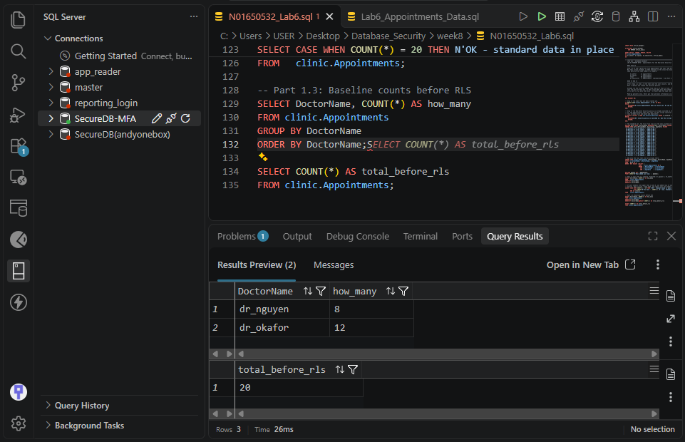
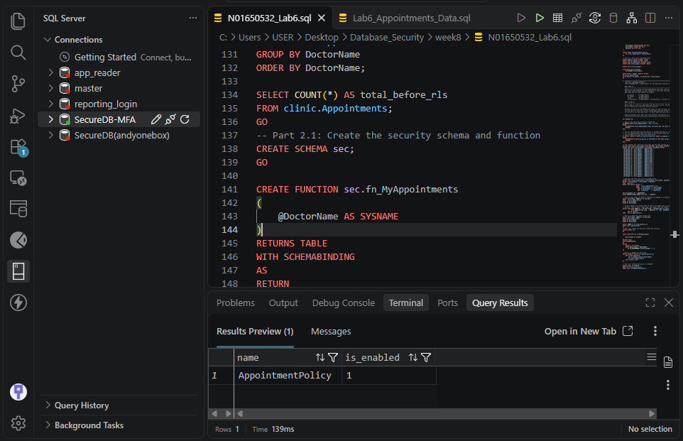
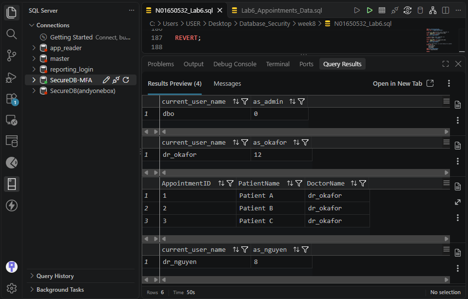
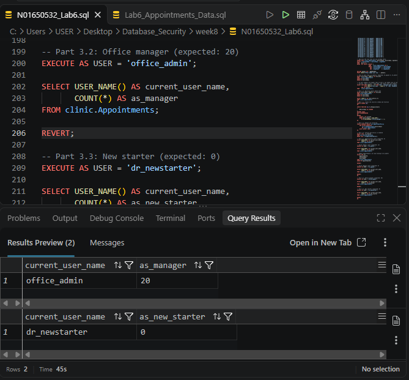
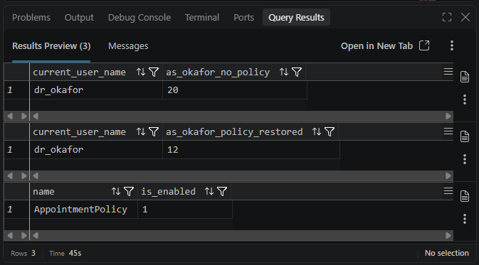

# Azure SQL Row-Level Security

An Azure SQL Database project demonstrating database-enforced row access for a clinic appointments table. Built by Chidiebere Ohanson for CPAN 363 Database Security.

## Recorded results

| Context | Rows seen | Policy |
|---|---:|---|
| Administrator dbo | 0 | On |
| dr_okafor | 12 | On |
| dr_nguyen | 8 | On |
| office_admin | 20 | On |
| dr_newstarter | 0 | On |
| dr_okafor | 20 | Off |
| dr_okafor after restoration | 12 | On |

The final policy state is enabled. Screenshots document the execution results; they are not generated query output.

## Implementation

- `clinic.Appointments`: 20 fictional appointments, with DoctorName identifying ownership.
- `IX_Appointments_Doctor`: index on the ownership column.
- `sec.fn_MyAppointments`: schema-bound inline table-valued predicate function.
- `sec.AppointmentPolicy`: FILTER predicate attached to the table.
- `office_manager`: role that allows access to all appointments.
- `EXECUTE AS USER` and `REVERT`: impersonation tests for each user.

## Run the lab

1. Connect to your own Azure SQL lab database as the database owner. Only the Lab 1 database is required.
2. Open [the complete SQL script](sql/N01650532_Lab6.sql) in a client that supports GO batch separators, such as the SQL Server extension in VS Code.
3. On a database without these lab objects, run Part 1.1 and Part 1.2 once.
4. Run the embedded standard-data section before enabling RLS. It adds missing standard rows and checks for enabled security policies.
5. Capture the baseline counts: 12 for dr_okafor and 8 for dr_nguyen.
6. Run Part 2 to create the function and enabled policy.
7. Run all Part 3 user tests, including each REVERT.
8. Run the entire Part 4 comparison block so the policy finishes enabled.

The full setup is not a rerunnable migration: CREATE statements fail if the objects already exist. The data-loading section alone avoids duplicate standard appointments when its preconditions hold. Its guard checks for any enabled security policy in the database.

## Why the administrator sees zero

RLS filters dbo too. No appointment belongs to dbo, and the database owner cannot be a member of office_manager. The supplied predicate contains no owner bypass. The observed zero count is correct.

## Evidence

### Baseline counts before Row Level Security

The baseline shows dr_nguyen with 8 rows, dr_okafor with 12 rows and 20 appointments in total.

### Enabled security policy

AppointmentPolicy has is_enabled equal to 1.

### Administrator and doctor tests

The administrator dbo sees 0 rows, dr_okafor sees 12 and dr_nguyen sees 8. The three sample rows are Patient A, Patient B and Patient C, all owned by dr_okafor.

### Manager and new starter tests

office_admin sees all 20 appointments. dr_newstarter sees zero, demonstrating that a user without assigned appointments receives no rows.

### Policy comparison and final state

dr_okafor sees 20 rows with the policy disabled and 12 after it is restored. The final policy state is enabled, with is_enabled equal to 1.

## Limits and further work

This lab demonstrates row filtering, not column hiding or encryption. A FILTER predicate does not by itself prevent inserting a row for another owner or changing an accessible row to a different owner; a production design should evaluate BLOCK predicates and narrower write permissions. Users able to alter the policy can disable the filtering. No write-isolation tests were performed in this lab.

## Files

- `sql/`: original uploaded SQL script, unchanged.
- `screenshots/`: execution evidence.
- `docs/`: completed lab report including the scripts and written answers.
- `UPLOAD_TO_GITHUB.md`: upload instructions.

## Learning materials

CPAN 363 Lab 6 Row-Level Security; Week 8 Showing Only Some Rows; supplied Lab6_Appointments_Data.sql and administrator-result clarification. Course handouts are referenced rather than redistributed.
